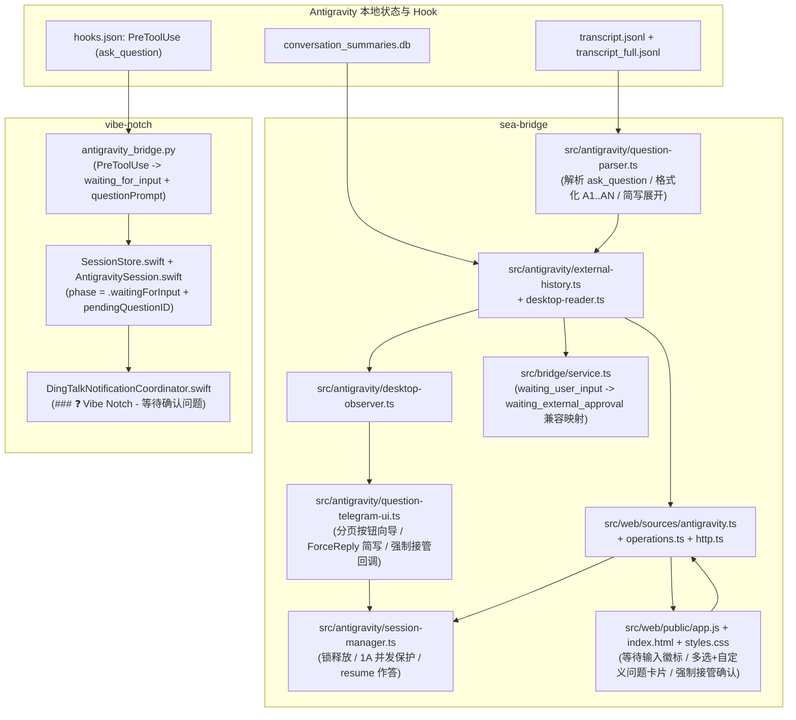

# Antigravity `ask_question` 等待输入状态呈现、钉钉通知与 Web/Telegram 接管作答设计规范

- **日期**：2026-11-11
- **涉及仓库**：
  - `/opt/app/aitools/sea-bridge`（Web 控制台、Telegram Bot、`agy acp` 会话接管、`bridge.sock` 兼容层）
  - `/opt/app/aitools/vibe-notch`（macOS 刘海屏状态机、Antigravity `hooks.json` 桥接、钉钉通知）
- **状态**：已获用户方案确认（决策 `1A` / `2A` / `3C`），进入规范审阅门禁（User Review Gate）

---

## 1. 背景与根因分析

当 Antigravity 会话在桌面端（`Antigravity.app`）或 CLI（`agy`）中调用内置交互式提问工具 `ask_question` 时，界面进入 `Asking N questions / Waiting for user input` 挂起态，等待用户选择或输入答案。但在现有跨端链路中存在以下断层：

1. **底层磁盘状态与运行态混淆**：
   - 在 `~/.gemini/antigravity/conversation_summaries.db`（及 `antigravity-cli`）中，挂起于 `ask_question` 的会话仍保持 `status = 'CASCADE_RUN_STATUS_RUNNING'` 且 `not_fully_idle = 1`。
   - `conversations/<id>.db` 的 `steps` 表停留在待完成步骤，而 `~/.gemini/antigravity/brain/<id>/.system_generated/logs/transcript.jsonl` 的最后一步为 `type: "PLANNER_RESPONSE"`，其 `tool_calls` 中包含 `{"name": "ask_question", "args": {"questions": ...}}`。
   - 当 `thinking` 或 `tool_calls` 较长时，`transcript.jsonl` 会标记 `truncated_fields: ["thinking", "tool_calls"]` 并截断参数，必须从同行/同 `step_index` 的 `transcript_full.jsonl` 回填完整对象。
   - 历史与实盘样本表明，`tool_calls[].args.questions` 既可能是已解析的 JSON 数组，也可能是二次序列化的 JSON 字符串（`"[{\"is_multi_select\":false,...}]"`），且单步 `PLANNER_RESPONSE` 的 `content` 可能为空字符串（直接调用工具）或包含前置说明正文。
2. **Web 控制台无法展示卡片也无法直接作答**：
   - `sea-bridge` 将该状态一律映射为 `state: "running"`（显示 `● 执行中`）与 `sendEnabled: false`，且仅把工具名 `ask_question` 推入 `activeTurnItems`，既未渲染问题选项卡片，也禁用了输入框。
3. **Telegram 与钉钉完全静默**：
   - `AntigravityDesktopObserver` 仅在桌面会话变为 `idle` 时才推送终态消息，导致 `ask_question` 挂起期间 Telegram 无任何提醒。
   - `vibe-notch` 的 `~/.gemini/config/hooks.json` 仅注册了 `UserPromptSubmit / PreInvocation / PostToolUse / Stop`，未注册 `PreToolUse (ask_question)`，而模型挂起等待输入时不会触发 `Stop`，因此刘海屏与钉钉均无通知。
4. **桌面端排他文件锁（`presence/<sessionId>.lock`）阻塞外部直接续写**：
   - 经对 `agy 1.5.2` 与进程句柄的实证检查，`Antigravity.app` 内置 `language_server` 在打开或挂起某会话时持有 `~/.gemini/antigravity/presence/<sessionId>.lock` 的排他锁（`presence.HeldElsewhere`）。
   - `agy 1.5.2` 已支持在 `session/resume` 时自动将上一轮未决提问表单干净收敛为 `cancelled` 并继续注入新一轮用户回答，但前提是先释放 `Antigravity.app` 持有的 `<sessionId>.lock`。

---

## 2. 已确认的核心设计决策

1. **桌面端接管并发保护策略（决策 `1A`）**：
   - 当从 Web 或 Telegram 接管回答一个当前被 `Antigravity.app` 持有锁的 `waiting_user_input` 桌面会话时，先检查 `Antigravity.app` 中是否存在**其他正在真实执行中（`state === "running"`，排除 `idle` 及同样处于 `waiting_user_input` 的会话）**的桌面会话：
     - **无其他运行中桌面会话**：自动优雅退出 `Antigravity.app` 释放 `<sessionId>.lock` -> 通过 `agy acp --app-data-dir=antigravity` 执行 `session/resume` 并提交格式化回答 -> 本轮执行落盘结束后自动重新拉起 `Antigravity.app` 并深链定位回原项目。
     - **存在其他运行中桌面会话且未显式确认强制接管（`forceDesktopTakeover !== true`）**：拒绝静默重启桌面端，返回确定性错误码 `desktop_takeover_confirm_required`。Web 端弹出二次确认框（确认后携带 `forceDesktopTakeover: true` 与新 `operationId` 提交）；Telegram 端展示 `[⚠️ 强制重启桌面端并提交]` / `[取消]` 内联确认按钮。
2. **Telegram 端多题与多选交互形态（决策 `2A`）**：
   - **单题单选**：直接渲染各选项为一键提交按钮（附带 `💬 回复` 自定义输入入口）。
   - **多题（`1/N .. N/N`）或含多选题（`is_multi_select: true`）**：采用**原消息内联按钮分页向导**（点击选项切换选中态或跳至下一题，`editMessageReplyMarkup` 原地刷新 `◀ 1/N ▶` 导航与 `☑️/⬜` 标记，最后一页提供 `✅ 提交全部回答`），同时保留 `💬 回复` ForceReply 入口，支持数字简写（如 `1 1 1 1`、`1,2,1,3`、`1+2 1` 自动展开为完整选项文案）或自由文本原样透传。
3. **Vibe Notch 与钉钉通知边界（决策 `3C`）**：
   - **不在** Vibe Notch 中新增 `Sea-Bridge Web URL` 配置项，也**不改动**现有 Codex 钉钉通知逻辑。
   - 在 Vibe Notch 的 Antigravity Hook 安装器与桥接脚本中新增 `PreToolUse`（`matcher: "ask_question"`），驱动刘海屏进入 `.waitingForInput` 状态，并向钉钉发送独立的 `### ❓ Vibe Notch - 等待确认问题` Markdown 通知，完整列出项目名、会话主题、等待状态、当前用户指令及全部 `Q1..QN` 问题与候选选项。

---

## 3. 目标与非目标

### 3.1 目标（Goals）
- 准确识别 Antigravity 桌面端、CLI 端及 Sea-Bridge 托管会话的 `ask_question` 待输入状态，暴露统一状态 `waiting_user_input`（UI 展示为 `等待输入`）。
- 在 Web 控制台支持单题/多题、单选/多选（`multiSelect`）及逐题“其他（自定义输入）”交互卡片，提交格式对齐 Antigravity 原生回答规范（单题直接发送答案文本，多题发送 `A1: ...\nA2: ...`）。
- 在 Telegram 支持幂等的 `❓ Antigravity 等待输入` 实时通知、原地分页按钮向导、数字简写解析与并发冲突二次确认。
- 在 Vibe Notch 支持 `PreToolUse (ask_question)` 实时捕获、刘海屏 `.waitingForInput` 状态展示与按 `(conversationId, generation, stepIdx)` 独立去重的钉钉问题通知。
- 保持 `LocalBridgeService`（`bridge.sock`）向后兼容，确保下游 `toolhub` 不会因新增状态出现类型不匹配或误判任务已完成。

### 3.2 非目标（Non-Goals）
- 不探测或逆向调用 `Antigravity.app` 内部未公开的本地 gRPC/HTTP 端口，也不直接写入 `~/.gemini/antigravity` 下的 SQLite 数据库。
- 不修改 Codex 或 DSH 的既有提问解析与钉钉通知行为。
- 不引入任何新的第三方依赖库。

---

## 4. 模块划分与架构设计

为遵循单文件 `< 400` 行的模块化红线，新增逻辑拆分为职责单一的纯函数与轻量协调模块：



---

## 5. Sea-Bridge 详细设计

### 5.1 问题解析与答案格式化模块（新建 `src/antigravity/question-parser.ts`）

该模块为无副作用纯函数集合，负责解析 `ask_question` 工具载荷、格式化回答及展开 Telegram 数字简写：

1. **类型扩展（`src/web/sources/types.ts`）**：
   ```ts
   export interface WebQuestionPrompt {
     title: string;
     options?: string[];
     multiSelect?: boolean;
   }
   ```
   `WebSession["state"]` 扩展为：
   ```ts
   state: "running" | "idle" | "unknown" | "waiting_external_approval" | "waiting_user_input";
   ```

2. **`extractAskQuestionPrompts(toolCalls: unknown): WebQuestionPrompt[]`**：
   - 遍历 `PLANNER_RESPONSE` 步骤的 `tool_calls`，筛选 `name === "ask_question"` 的调用。
   - 读取 `args.questions`：
     - 若为 `string`，先尝试 `JSON.parse`；解析失败则安全忽略并返回空数组。
     - 若为数组，逐项校验 `question`（非空字符串 -> `title`）、`options`（过滤空白字符串后的 `string[]`）、`is_multi_select`（布尔值 -> `multiSelect`）。
   - 返回规范化后的 `WebQuestionPrompt[]`。

3. **挂起态判定规则（集成于 `src/antigravity/external-history.ts` 与 `src/antigravity/desktop-reader.ts`）**：
   - **列表级按需探测（高性能保证）**：在 `AntigravityDesktopReader` 扫描 `conversation_summaries.db` 时，仅当某行满足 `isRunning === true`（`status === "CASCADE_RUN_STATUS_RUNNING" || Boolean(not_fully_idle)`，通常同时仅 0~3 个会话）时，才调用轻量尾部检查函数 `inspectPendingAskQuestion(appDataDirPath, conversationId)` 读取对应 `transcript.jsonl`（若末行含 `truncated_fields` 则按行号/`step_index` 从 `transcript_full.jsonl` 水合），对处于 `idle` 的历史会话零额外文件 I/O。
   - **挂起成立条件**：`isRunning === true`，且当前轨迹最后一个有效业务步骤为 `type === "PLANNER_RESPONSE"`，其水合后的 `tool_calls` 解析出非空 `WebQuestionPrompt[]`。一旦后续写入了新的 `USER_INPUT` 或工具结果步骤，最后一个有效步骤不再是该 `PLANNER_RESPONSE`，挂起态自动解除。
   - **历史消息投影规则（避免吞掉前置正文）**：
     - 当 `PLANNER_RESPONSE` 同时包含说明正文 `replyText` 与 `ask_question` 时，`readBrainTranscriptHistory` 先推入普通助手消息 `{ id: "${stepId}-assistant", role: "assistant", text: replyText, createdAt }`，再紧跟推入独立的问题卡片消息 `{ id: "${stepId}-question", role: "assistant", text: "", createdAt, questions }`（仅对当前处于挂起态的末尾步骤附加交互式 `questions`，已作答的历史步骤不重复渲染可提交卡片）。
     - 若 `replyText` 为空字符串但存在挂起问题，仍推入 `{ id: "${stepId}-question", role: "assistant", text: "", createdAt, questions }`，确保卡片必然可见。
     - 在挂起态下，从 `activeTurnItems` 中剔除裸工具项 `"ask_question"`，避免底部重复显示 `🔍 ask_question`。

4. **回答组装与简写展开**：
   - `formatAntigravityQuestionAnswers(answers: readonly string[]): string`：
     - 若有效题目数为 `1`：直接返回 `answers[0].trim()`。
     - 若有效题目数 `> 1`：按 Antigravity 原生多题格式拼接为 `A1: ${answers[0]}\nA2: ${answers[1]}...`。
   - `expandQuestionShorthandReply(rawText: string, questions: readonly WebQuestionPrompt[]): string`：
     - 支持用户在 Telegram 回复纯序号简写：题目之间以空白符、英文逗号、中文逗号或分号分隔（当题目数 `> 1` 时 token 数量须等于 `questions.length`；单题时允许单个 token），多选题单个 token 内支持 `+` 或 `/` 连接多个 1-based 序号（如 `1+3`）。
     - 若全部序号均为对应题目 `options` 范围内的合法整数（`1 <= idx <= options.length`），自动展开为对应选项原文并调用 `formatAntigravityQuestionAnswers`（多选项以 `；` 拼接）。
     - 凡不符合纯序号简写语法或越界的输入，视为自由文本回答，**原样返回 `rawText.trim()`**，绝不报错拦截。

### 5.2 ACP 托管会话与桌面会话接管写链路

1. **受管 ACP 会话与外部 CLI 会话的 `ask_question` 兼容（`src/antigravity/client.ts`、`src/antigravity/external-history.ts`、`src/web/sources/antigravity.ts`）**：
   - 经对 `agy 1.5.2` 二进制行为核实：在 Sea-Bridge 托管的 `agy acp` 子进程中，未声明 `elicitation` 客户端能力时，`agy` 收到 `-32601` 会自动触发内置降级（`elicitation/create rejected ... asking in chat instead`）并正常结束当前轮次（`status: "idle"`），用户可直接在下一轮发送回答；同时若轨迹中记录了未作答的末尾 `ask_question` 步骤，`readBrainTranscriptHistory` 同样将其渲染为交互式 `questions` 卡片，方便用户在 Web 端直接点选作答。
   - 对于用户在外部终端直接启动并挂起于 `ask_question` 的 CLI 会话（位于 `~/.gemini/antigravity-cli`，`clientKind === "cli"`）：`desktopReader` 同样识别 `waitingUserInput === true` 并在 Web 端展示问题卡片，但接管时**绝不退出 `Antigravity.app`**（锁位于 `antigravity-cli/presence/<id>.lock`；若外部 `agy` 终端进程仍持有该锁导致 `session/resume` 失败，则返回明确错误码 `session_resume_failed` 提示先结束终端占用）。
   - 在 `AntigravityWebSource.sessions()` 与 `history()` 中，若底层 `desktopReader` 报告 `waitingUserInput === true` 且当前无 Sea-Bridge 自身活跃 turn，则无论该会话是否已被 `antigravity_sessions` 表收编（P4 adopted），统一投影 `state: "waiting_user_input"` 且 `sendEnabled: canWrite`（不再因 `externallyRunning` 将输入框锁死）。

2. **写请求参数透传（`forceDesktopTakeover?: boolean`）**：
   - `WebWriteRequest`（`src/web/operations.ts`）新增可选字段 `forceDesktopTakeover?: boolean`；仅当 `forceDesktopTakeover === true` 时写入 `buildDigestPayload`，保持常规请求摘要完全不变。
   - `POST /api/sessions/:source/:id/messages`（`src/web/http.ts`）解析可选布尔字段 `body.forceDesktopTakeover === true` 并传入 `dispatchWebOperation`。
   - `WebSource.send(id, operationId, prompt, options?: { forceDesktopTakeover?: boolean })` 透传至 `AntigravitySessionManager.send(sessionId, operationId, prompt, options)`。

3. **桌面会话排他锁释放与 `1A` 并发保护（`src/antigravity/session-manager.ts` + `src/antigravity/desktop-app-controller.ts`）**：
   - `AntigravityDesktopReader` 的 `ExternalSessionInspection` 新增 `waitingUserInput: boolean`：
     - 当 `waitingUserInput === true` 时，`listSessions()` / `listExternalSessions()` 返回 `state: "waiting_user_input"`。
     - 因此 `AntigravityDesktopAppController.hasOtherRunningDesktopSession(excludeSessionId)` 维持 `s.id !== excludeSessionId && s.state === "running"` 即可天然排除 `idle` 与其他处于 `waiting_user_input` 的会话，仅对真正执行中的其他桌面会话触发保护。
   - 在 `AntigravitySessionManager.resolveOrAdoptSession(sessionId)` 中：
     - 若外部会话 `ext.externallyRunning === true` 但 `ext.waitingUserInput === true`，**允许通过**（不再直接返回 `session_busy`），并在首次收编时记录 `sessionOrigin: "desktop"`。
   - 在 `AntigravitySessionManager.send(sessionId, operationId, prompt, options)` 中：
     - 当目标会话属于桌面目录（`session.sessionOrigin === "desktop"`）且外部正处于 `waitingUserInput === true`（或 `desktopAppController.isSessionOpenInDesktopApp(sessionId)` 为 `true` 且外部 `externallyRunning` 因 `waitingUserInput` 挂起）时：
       1. 调用 `await desktopAppController.isSessionOpenInDesktopApp(sessionId)` 检查 `Antigravity.app` 是否持有该会话锁。
       2. 若持有锁：
          - 检查 `desktopAppController.hasOtherRunningDesktopSession(sessionId)`：
            - 若为 `true` 且 `options?.forceDesktopTakeover !== true`：立即返回 `{ state: "failed", sessionId, errorCode: "desktop_takeover_confirm_required" }`（不退出桌面端、不启动 worker）。
          - 调用 `const quitOk = await desktopAppController.quitDesktopApp(sessionId)` 释放 `<sessionId>.lock`：
            - 若 `!quitOk`：返回 `{ state: "failed", sessionId, errorCode: "desktop_app_busy_lock" }`。
          - 记录 `desktopAppController.markReopenAfterTurn(sessionId, options?.notifyChatId)`，使得本轮后台 `agy acp` 完成后（在 `onDesktopTurnSettled` 中），即使此时 `Antigravity.app` 已处于关闭状态，也会在无冲突时自动调用 `reopenDesktopApp(sessionId)` 重新打开桌面端并定位到原项目！
       3. 随后走标准 `ensureIdleActor(session)`（`agy acp --app-data-dir=antigravity` 执行 `session/resume` 收敛旧提问并发送 `prompt`）。

4. **`LocalBridgeService`（`bridge.sock`）向后兼容映射（`src/bridge/service.ts`）**：
   - 下游 `toolhub` 的 `BridgeSessionSummary["state"]` 严格定义为 `"running" | "idle" | "unknown" | "waiting_external_approval"`，且仅在 `state === "idle"` 时将任务置为待验收。
   - 因此在 `LocalBridgeService.getSessionSummary` 中，若上游 `WebSession["state"]` 或 `WebHistory["sessionState"]` 为 `"waiting_user_input"`，统一映射为 `"waiting_external_approval"`（并计入 `pendingApprovalsCount >= 1`），保证 `toolhub` 安全等待用户作答而不会误判结束或破坏类型契约。

### 5.3 Web 控制台交互设计（`src/web/public/index.html`、`src/web/public/app.js`、`src/web/public/styles.css`、`src/web/http.ts`）

1. **状态展示与筛选**：
   - `labels` 字典新增 `waiting_user_input: "等待输入"`，渲染醒目的琥珀色状态徽标。
   - `src/web/http.ts` 的 `GET /api/sessions?activity=...` 白名单加入 `"waiting_user_input"`；`index.html` 状态筛选下拉框新增 `<option value="waiting_user_input">等待输入</option>`。
   - 概览页“待处理审批/输入”统计卡片同时计入 `waiting_external_approval` 与 `waiting_user_input`。
   - 选中处于 `waiting_user_input` 的会话时：
     - 保持 `isReadOnlyDesktopSession` 为 `false`（允许可写桌面会话直接作答），启用底部输入框与问题卡片提交按钮。
     - 活动状态条显示 `等待输入 · 请在问题卡片中选择或直接输入回复`。
     - 轮询保活判断（`active`）包含 `"waiting_user_input"`，以便用户在桌面端或 Telegram 作答后 Web 页面自动刷新为执行中/空闲。

2. **增强版 `renderQuestionCard(message)`**：
   - 保持对 Codex 单选问题卡片 100% 兼容，同时支持 Antigravity 新增能力：
     - 多题时展示题号前缀 `1/N` .. `N/N`；若 `q.multiSelect === true` 标注 `（可多选）`，选项列表使用 `role="group"` + 复选框样式支持多选切换（默认不强制预选或默认选中首项可取消），单选题保持 `role="radiogroup"`。
     - 每道包含预设选项的题目末尾提供 `其他（自定义输入）` 切换项，点击后展开单行/多行内联输入框，输入内容实时同步到该题答案槽位。
     - 点击卡片底部“发送”按钮时，调用与后端一致的组装逻辑（单题直接发送所选/自定义文本，多题生成 `A1: ...\nA2: ...`）并通过 `submitWrite(false, formattedAnswer)` 提交。

3. **桌面接管冲突二次确认**：
   - `labels` 与错误映射表补充：
     - `desktop_takeover_confirm_required`: `"检测到 Antigravity 桌面端有其他会话正在运行，需确认后强制接管"`
     - `desktop_app_busy_lock`: `"未能释放 Antigravity 桌面端会话锁，请先关闭桌面端弹窗后重试"`
   - 在 `submitWrite` 中，若收到 `operation.state === "failed" && operation.errorCode === "desktop_takeover_confirm_required"` 且当前请求未设置 `forceDesktopTakeover`：
     - 若浏览器环境存在 `typeof window.confirm === "function"`：弹出确认框说明“检测到 Antigravity 桌面端当前有其他会话正在执行任务。提交回答需要临时退出并重启 Antigravity.app，是否强制接管并提交？”，用户确认后以新 `operationUuid()` 携带 `{ forceDesktopTakeover: true }` 重新提交；取消则保留草稿与卡片选择态。
     - 若无 `window.confirm`（如无头测试环境）：通过 `notice(..., { sticky: true, kind: "warning" })` 展示提示及可点击的“强制接管并提交”重试按钮。

### 5.4 Telegram 通知、原地分页向导与数字简写回复

1. **实时检测与去重入箱（`src/antigravity/desktop-observer.ts`）**：
   - 在 `observeDesktopSessions()` 中（无需等待 `desk.state === "idle"`）：
     - 若 `desk.state === "waiting_user_input"`，定位 `history.messages` 末尾携带 `questions` 的消息（如 `step-42-question`）及其前置说明正文（若有）。
     - 以 `sha256({ origin: "desktop", sessionId: desk.id, kind: "ask_question", questionMessageId })` 作为幂等 `eventFingerprint`，即使首次发现该会话（无历史 `prev` 游标），只要当前正处于实时 `waiting_user_input` 且尚未入箱该指纹，即入箱一条 `eventKind: "waiting_input"` 通知（为防止服务重启时回放久远陈旧会话，限定 `Date.now() - desk.updatedAt <= 24 * 60 * 60_000`）。
     - 消息正文格式：标题 `❓ Antigravity 等待输入 [桌面端]`，附会话标题、精简前置上下文摘要（若过长则优先裁剪前置正文，**完整保留末尾问题与选项列表**）以及操作提示（支持点击按钮选择，或点击 `💬 回复` 发送如 `1 1 1 1` 的序号简写/自由文本）。
     - 终态助手消息游标仅统计非问题卡片消息（`!m.questions?.length && m.text.trim().length > 0`），保证提问卡片不会错乱 `idle` 终态通知游标。

2. **分页按钮向导与回调协议（新建 `src/antigravity/question-telegram-ui.ts` + 扩展 `src/antigravity/telegram-store.ts` & `telegram-handler.ts`）**：
   - 在 `antigravity_telegram_state` 表中持久化两类带 24h TTL 的状态（无需新增 SQLite 表迁移）：
     - `qmeta:<chatId>:<messageId>`：保存 `{ sessionId, sessionOrigin, questions: WebQuestionPrompt[] }`，供按钮向导与 ForceReply 简写展开共用（当用户点击 `💬 回复` 产生 `reply_prompt` 消息时，将该 `qmeta` 同步关联到 `promptMsg.message_id`，使直接回复通知消息或回复 ForceReply 提示消息均能触发序号简写展开！）。
     - `qwiz:<chatId>:<messageId>`：保存向导草稿 `{ sessionId, sessionOrigin, questions, currentIndex, selections: number[][], status: "active" | "submitted" }`。
   - **键盘渲染规则**：
     - **单题单选（`questions.length === 1 && !questions[0].multiSelect`）**：每行渲染一个选项按钮 `[1. 选项摘要]`（`action: "q.pick"`，点击即锁定并直接投递），末行渲染 `[💬 回复（自定义）]`。
     - **多题或含多选题**：
       - 当前页 `q = questions[currentIndex]`：每行渲染当前题各选项按钮（单选显示 `🔘/⚪ 1. ...`，多选显示 `☑️/⬜ 1. ...`）。
       - 单选题点击选项后记录选择；若非最后一题则自动推进 `currentIndex + 1` 并调用 `editMessageReplyMarkup` 刷新键盘！
       - 多选题点击选项切换选中集合并原地刷新按钮勾选态。
       - 导航与操作行：`[◀ 上一题]`、`[第 k/N 题]`、`[下一题 ▶]`，以及当所有题目均至少选定一项（或处于最后一页）时展示 `[✅ 提交回答]` 按钮，末行始终保留 `[💬 回复（简写/自定义）]`。
     - **Token 生命周期**：所有向导回调继续复用 `createAntigravityCallback` 单次消费令牌，每次 `editMessageReplyMarkup` 重新生成当前页最新有效按钮令牌，天然具备防重放与 `chatId` 绑定保护。
   - **桌面接管冲突按钮**：
     - 当按钮提交或文本回复收到 `desktop_takeover_confirm_required` 时，向用户发送提示消息并附带一次性确认按钮：
       - `[⚠️ 强制重启桌面端并提交]`（`action: "q.force_submit"`，载荷保存 `{ sessionId, sessionOrigin, answerText }`）
       - `[✖️ 取消]`（`action: "q.cancel_force"`，清除确认键盘）。

3. **回复路由支持简写展开与强制接管（`src/antigravity/reply-router.ts`）**：
   - `AntigravityReplyRouter.deliver` 在读取 `link` 后，查询 `tgStore.getQuestionMeta(chatId, replyMessageId)`：若命中 `questions`，先通过 `expandQuestionShorthandReply(normalized, questions)` 转换答案文本，再计算幂等哈希并调用 `sessionManager.send(sessionId, operationId, expandedText, options)`。
   - 当 `result.errorCode === "desktop_takeover_confirm_required"` 时，返回明确状态 `{ status: "desktop_takeover_confirm_required", sessionId, expandedText }`，由上层 Telegram 处理器渲染强制接管确认按钮。

---

## 6. Vibe Notch 与钉钉通知详细设计（`/opt/app/aitools/vibe-notch`）

### 6.1 Hook 安装器扩展（`ClaudeIsland/Services/Hooks/AntigravityHookInstaller.swift`）

1. 在 `antigravityHookEventNames` 与 `buildAntigravityHooksObject` 中新增 `"PreToolUse"`：
   - 严格遵循 Antigravity 官方 `hooks.json` 规范，为 `PreToolUse` 生成带 `matcher: "ask_question"` 的结构：
     ```json
     "PreToolUse": [
       {
         "matcher": "ask_question",
         "hooks": [
           {
             "type": "command",
             "command": "/usr/bin/python3 \"/Users/<user>/.gemini/config/vibe-notch/antigravity_bridge.py\" PreToolUse",
             "timeout": 2
           }
         ]
       }
     ]
     ```
   - 采用幂等合并策略：保留用户在 `PreToolUse` 下可能已配置的其他非 `vibe-notch` Hook 条目，仅替换/升级包含 `antigravity_bridge.py` 的条目。
2. 更新 `inspectConfiguration` 健康自检逻辑，验证 `PreToolUse` 钩子已安装且脚本支持 `PreToolUse`，未升级时自动平滑重写 `~/.gemini/config/hooks.json` 与 `~/.gemini/config/vibe-notch/antigravity_bridge.py`。

### 6.2 Python 桥接脚本扩展（`ClaudeIsland/Resources/antigravity_bridge.py`）

1. `SUPPORTED_EVENTS` 新增 `"PreToolUse"`。
2. 当 `hook_event == "PreToolUse"` 时：
   - 检查 `payload.get("toolCall", {}).get("name") == "ask_question"`；若非 `ask_question`（防御性兜底），直接输出 `{}` 并退出 `0`，不向 Socket 发送状态变更。
   - 解析 `toolCall.args.questions`（兼容 `list` 与 JSON `str` 两种形态），提取最多前 10 道题、每题最多 8 个选项并做长度裁剪，构造结构化列表：
     ```json
     "questionPrompt": {
       "stepIdx": 42,
       "questions": [
         {
           "question": "Sea-Bridge 会话列表与 ToolHub 卡片的来源展示名称，采用哪种统一规范？",
           "options": ["(Recommended) 统一精简英文端名...", "统一保留“创建”后缀...", "统一中文端名..."],
           "multiSelect": false
         }
       ]
     }
     ```
   - 将消息 `status` 设为 `"waiting_for_input"`，连同 `lastUserInput`、`transcriptPath`、`workspacePaths` 一起通过 `/tmp/claude-island.sock` 发送给 Vibe Notch。
   - **Fail-open 铁律**：无论 Socket 是否在线或解析是否异常，标准输出**永远只打印 `{}` 并以退出码 `0` 结束**，绝不阻塞或篡改 Antigravity 本身的 `ask_question` 执行。

### 6.3 刘海屏状态机与会话模型（`AntigravitySession.swift` + `SessionStore.swift` + `AntigravityNotificationContextLoader.swift`）

1. `AntigravityQuestionItem` 与 `AntigravitySession` 模型扩展：
   - 定义 `AntigravityQuestionItem: Equatable, Sendable`（`question: String`, `options: [String]`, `multiSelect: Bool`）。
   - `AntigravitySession` 新增：
     - `isWaitingForUserInput: Bool`
     - `pendingQuestionID: String?`（格式：`"\(conversationId):\(generation):q:\(stepIdx)"`）
     - `pendingQuestions: [AntigravityQuestionItem]`
   - 当收到 `PreToolUse (ask_question)` 事件时：
     - 设置 `isWaitingForUserInput = true`、`pendingQuestionID` 与 `pendingQuestions`，并通过 `AntigravityNotificationContextLoader` 只读补齐 `title`（若当前 `sessionTitle` 为空）。
     - 映射刘海屏 `SessionPhase` 为 `.waitingForInput`（使 Mac 刘海屏即时亮起等待输入提示，而非一直转圈显示 `.processing`）。
   - 当后续收到同会话的 `PostToolUse`、`PreInvocation`、`UserPromptSubmit` 或 `Stop` 事件时：
     - 自动清除 `isWaitingForUserInput = false` 与 `pendingQuestions = []`，平滑恢复至 `.processing` 或 `.idle`。

### 6.4 钉钉独立通知格式与去重（`DingTalkNotificationCoordinator.swift`）

1. **独立去重集合**：
   - 新增 `notifiedAntigravityQuestionIDs: Set<String>`（按 `pendingQuestionID` 去重），与回合结束的 `completionID` 完全解耦，确保：
     - 同一轮中多次不同的 `ask_question`（不同 `stepIdx`）各自准确通知一次；
     - 用户回答后本轮最终 `Stop` 完成时，仍正常发送原有的 `### 🤖 Vibe Notch - 任务完成` 通知。
2. **Markdown 消息排版**：
   - 推送标题：`❓ [项目名] 等待输入`
   - 正文模板：
     ```markdown
     ### ❓ Vibe Notch - 等待确认问题
     - **来源**: Antigravity
     - **项目**: toolhub
     - **主题**: ToolHub Task Execution Source Alignment
     - **状态**: ⏳ 等待输入 (共 4 个问题)

     **当前指令**:
     > 对比对齐两个地方的来源名称...

     **待确认问题**:
     **Q1. Sea-Bridge 会话列表与 ToolHub 卡片的来源展示名称，采用哪种统一规范？**（单选）
     1. (Recommended) 统一精简英文端名...
     2. 统一保留“创建”后缀...
     3. 统一中文端名...
     ```
   - 遵循既有钉钉载荷上限保护（超长时按字符上限安全截断末尾并附加省略提示）。

---

## 7. 异常与边界场景处理

| 场景 | 处理策略 |
| --- | --- |
| `transcript.jsonl` 中 `ask_question` 参数被截断（`truncated_fields` 含 `"tool_calls"`） | 自动按行索引及 `step_index` 从 `transcript_full.jsonl` 水合完整步骤；若 `transcript_full.jsonl` 缺失或损坏则降级为普通 `running`，绝不抛出未捕获异常。 |
| `args.questions` 为 JSON 字符串而非数组 | `extractAskQuestionPrompts` 先执行受保护的 `JSON.parse`，兼容数组与字符串双形态。 |
| `PLANNER_RESPONSE` 调用 `ask_question` 时 `content` 为空字符串 | 独立生成 `${stepId}-question` 消息承载 `questions`，不依赖 `replyText` 非空。 |
| 用户已在桌面端作答，但旧 Telegram 向导按钮仍被点击 | 提交时若会话已进入下一轮执行，`sessionManager.send` 返回 `session_busy`，Telegram 提示“该会话当前正在执行中，请稍后再试”。 |
| Web 与 Telegram 同时点击提交回答 | 单会话 actor 串行化与锁检查保证仅首个请求获得执行权，后者确定性收到 `session_busy`。 |
| 退出 `Antigravity.app` 超时（如桌面端存在未保存文件弹窗阻塞退出） | `quitDesktopApp` 返回 `false`，`sessionManager.send` 返回 `desktop_app_busy_lock`，Web 与 Telegram 明确提示用户先处理桌面端弹窗，不卡死后台进程。 |
| `vibe-notch` 未运行或 Socket 不可达时触发 `PreToolUse` | `antigravity_bridge.py` 捕获全部异常后静默输出 `{}` 并 `exit(0)`，对 Antigravity 零影响。 |

---

## 8. 测试与验证计划

1. **`sea-bridge` 单元测试与集成测试（`bun test` + `bun x tsc --noEmit`）**：
   - `tests/antigravity-question-parser.test.ts`：覆盖数组/JSON 字符串双形态 `questions`、`truncated_fields` 从 `transcript_full.jsonl` 水合、空正文 `PLANNER_RESPONSE`、`is_multi_select`、已回答历史步骤不误判挂起、`formatAntigravityQuestionAnswers` 单题/多题格式、`expandQuestionShorthandReply`（`1 1 1 1`、`1+2 3`、越界回退自由文本）。
   - `tests/antigravity-desktop-takeover.test.ts`：覆盖 `waiting_user_input` 状态下的 `1A` 并发保护（无其他运行会话自动 `quit -> resume -> prompt -> reopen`；有其他 `running` 会话返回 `desktop_takeover_confirm_required`；其他会话仅处于 `waiting_user_input` 时不误报冲突；携带 `forceDesktopTakeover: true` 强制放行）。
   - `tests/antigravity-question-telegram.test.ts`：覆盖 `AntigravityDesktopObserver` 实时入箱去重、单题一键按钮、多题/多选原地分页向导、ForceReply 序号简写展开、强制接管二次确认回调。
   - `tests/web-question-card.test.ts` & `tests/bridge-service.test.ts`：覆盖 Web `waiting_user_input` 筛选与卡片多选/自定义输入渲染、`desktop_takeover_confirm_required` 确认重试，以及 `LocalBridgeService.getSessionSummary` 对 `toolhub` 的 `waiting_external_approval` 兼容映射。
2. **`vibe-notch` 单元测试与构建验证**：
   - `PYTHONDONTWRITEBYTECODE=1 python3 -m unittest discover -s scripts/tests -q`：验证 `antigravity_bridge.py` 对 `PreToolUse (ask_question)` 与非 `ask_question` 工具的过滤、JSON 字符串参数兼容、`waiting_for_input` 载荷及 `{}` 标准输出。
   - `xcodebuild test -scheme ClaudeIsland -configuration Debug -destination 'platform=macOS' CODE_SIGNING_ALLOWED=NO`：新增 `AntigravityHookInstaller`（`PreToolUse` 幂等合并）、`SessionStore`（`.waitingForInput` 状态流转与恢复）及 `DingTalkNotificationCoordinator`（独立 `pendingQuestionID` 去重与 Markdown 渲染）单元测试。
